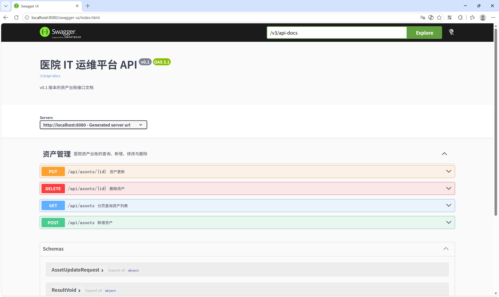

# 医院 IT 运维平台 · 资产台账（v0.1）
▶ **演示视频**：[B 站](https://www.bilibili.com/video/BV1DnsU6JECL) ｜ [备用下载](https://github.com/Gueaser/hospital-itops/releases/download/v0.1.0/demo-v0.1.0.mp4)

> 面向医院信息科的轻量资产台账后端。从零独立完成，Spring Boot 4 + MyBatis-Plus + MySQL 8。



## 这是什么

医院信息科要维护几百台设备：自助挂号机、叫号屏、核心交换机、机房 UPS……
这些信息现在大多散落在 Excel 里，想查一台机器上次保养是什么时候，要翻好几个表。

这个项目把「资产台账」做成了一组 REST API：登记设备、按科室和状态筛选、
记录保养日期、报废登记，并提供自动生成的接口文档。

**它不是** HIS（医院信息系统），不涉及挂号、收费、电子病历、医保结算。
**它也不是**完整产品 —— v0.1 没有前端界面，只有后端接口。

## 技术栈

| 层 | 选型 |
|---|---|
| 语言 | Java 17 |
| 框架 | Spring Boot 4.1.2 |
| 持久层 | MyBatis-Plus 3.5.18 |
| 数据库 | MySQL 8.0 |
| 接口文档 | springdoc-openapi 3.2.0（Swagger UI） |
| 测试 | JUnit 5 + MockMvc |
| 构建 | Maven（自带 Wrapper，无需预装） |

## 快速开始

### 1. 环境要求

- JDK 17 或以上
- MySQL 8.0 或以上

### 2. 建库建表

```bash
mysql -u root -p --default-character-set=utf8mb4 -e "source sql/01-asset.sql"
```

会创建 `hospital_ops` 库、`asset` 表，并插入 20 条示例数据。同时会返回文件内的三条测试用查询语句的结果。

⚠️ PowerShell 不支持 `<` 重定向，所以用上面的 `-e "source ..."` 写法，不要写 `mysql < xxx.sql`。
⚠️ 脚本中包含 `DROP TABLE IF EXISTS asset`，重复执行会清空 `asset` 表后重建。

### 3. 设置数据库密码

密码不写进代码，启动前通过环境变量传入。

PowerShell：
```powershell
$env:DB_PASSWORD="你的MySQL密码"
```

IDEA：Run → Edit Configurations → Environment variables 里加 `DB_PASSWORD`。

### 4. 启动

```bash
# Windows
.\mvnw.cmd spring-boot:run

# macOS / Linux
./mvnw spring-boot:run
```

### 5. 打开接口文档

http://localhost:8080/swagger-ui.html

看到「资产管理」分组下的 4 个接口，点 Try it out 就能直接调。

## 接口清单

| 方法 | 路径 | 说明 |
|---|---|---|
| GET | `/api/assets` | 分页查询，支持 `dept` / `status` 筛选 |
| POST | `/api/assets` | 新增资产 |
| PUT | `/api/assets/{id}` | 修改资产（部分更新语义） |
| DELETE | `/api/assets/{id}` | 删除资产 |

**统一返回体**：所有接口都返回同一种结构。

| 字段 | 类型 | 说明 |
|---|---|---|
| `code` | int | `0` 表示成功，非 0 为错误码 |
| `message` | string | 成功固定为「成功」，失败为具体原因 |
| `data` | 泛型 | 各接口不同，见下表 |
| `timestamp` | string | 服务端时间，格式 `yyyy-MM-dd HH:mm:ss` |

`data` 的形态随接口而变（这正是 `Result<T>` 用泛型的原因）：

| 接口 | `data` 内容 | 示例 |
|---|---|---|
| `GET /api/assets` | 分页对象 | `{"records":[...],"total":21,"size":10,"current":1,"pages":3}` |
| `POST /api/assets` | 新增记录的主键 | `21` |
| `PUT /api/assets/{id}` | 无回传数据 | `null` |
| `DELETE /api/assets/{id}` | 无回传数据 | `null` |

新增成功（返回新记录的 id）：

```json
{ "code": 0, "message": "成功", "data": 21, "timestamp": "2026-11-12 22:19:55" }
```

修改成功（没有需要回传的数据，所以 `data` 为 `null`）：

```json
{ "code": 0, "message": "成功", "data": null, "timestamp": "2026-11-12 22:19:55" }
```

错误码：`400` 参数校验失败 · `404` 资产不存在 · `409` 编号重复 · `500` 服务器内部错误

## 已验证

| 场景 | 结果 |
|---|---|
| 空 `name` 新增 | 400，`设备名不能为空` |
| 重复 `assetCode` 新增 | 409，`资产编号已存在` |
| 修改不存在的 id | 404，`资产不存在` |
| 删除不存在的 id | 404，`资产不存在` |
| 请求体带未知字段 | 400，明确指出字段名 |
| `?size=1000` | 400，`每页最多 100 条` |
| 分页 `?page=2` | 返回第 2 页，`total` 与库内一致 |

其中第 1 行和第 3 行已写成自动化测试（`src/test/java/com/ye/hospitalitops/controller/AssetControllerTest.java`），`./mvnw test` 可直接跑。

## 三个设计决定

### 1. 为什么接收请求用 DTO，而不是直接用实体类

直接使用Asset类接受请求，所有字段均可写，可能会导致用户通过请求体恶意传递id覆盖他人记录，使用DTO可以明确可写范围，从而避免越权修改和非法字段注入。

### 2. 为什么必须配分页插件

使用分页插件时，它会在 SQL 层面自动拼接 `LIMIT`，从而实现物理分页。而不使用时则进行假分页(内存分页)，这会对全表数据查询并加载到内存，当数据量过大会导致内存溢出。

### 3. 为什么开启「未知字段报错」

在默认情况下，如果发生拼写出错(如：location错写成loaction)，会导致Jackson反序列化时静默忽略这个未知字段，
结果就是，前端以为修改成功了，数据库却没变，且没有任何报错。开启 `fail-on-unknown-properties` 后，系统会直接抛出 400 异常，让前后端在联调阶段立刻发现字段拼写错误，防患于未然。

## 已知局限

- 没有认证和权限，任何人都能调用
- `DELETE` 是物理删除；真实系统应改为逻辑删除（历史工单会引用资产）
- `PUT` 实际是部分更新语义，不符合 HTTP PUT 的全量替换定义
- 返回体的 `code` 与 HTTP 状态码重复，v0.2 会拆分业务码
- 单元测试只覆盖 2 条路径（404、参数校验），正常增删改靠手工验证
- 没有前端，只能通过 Swagger 或 curl 调用

## 项目结构

```
hospital-itops/
├── docs/
│   ├── 01-需求.md      需求说明：角色、状态机、边界问题
│   ├── 进度.md         开发记录：每天做了什么、为什么这么决策
│   └── images/         截图
├── sql/01-asset.sql    建库建表 + 示例数据
├── src/main/java/com/ye/hospitalitops/
│   ├── common/         统一返回体、全局异常、业务异常
│   ├── config/         MyBatis-Plus 配置、OpenAPI 配置
│   ├── controller/     接口
│   ├── dto/            请求对象
│   ├── entity/         数据库实体
│   └── mapper/         MyBatis-Plus Mapper
└── src/test/           WebMvcTest 单元测试
```

## 版本计划

- **v0.1 资产台账**（当前）：增删改查、筛选、分页、接口文档
- **v0.2 工单**：报修、派单、状态流转（待受理 → 处理中 → 已完成）
- **v0.3 提醒**：保养到期提醒、重复告警合并

## 开发记录

`docs/进度.md` 记录了每天的进展、关键决策理由和踩过的坑。